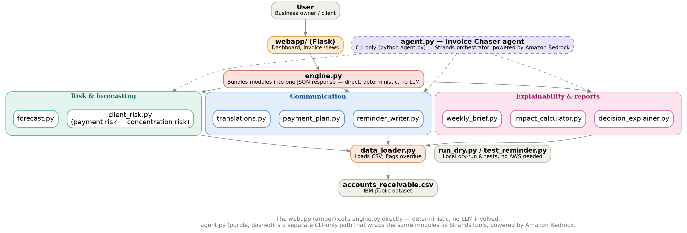

<div align="center">


**An AI agent that chases down unpaid invoices — so freelancers and small business owners don't have to.**

Built for the AWS "Agents for Humans" Hackathon · Professional Agents track

[](https://strandsagents.com)
[](https://aws.amazon.com/bedrock/)
[](https://www.python.org/)
[](https://flask.palletsprojects.com/)
[](LICENSE)

**[Live Demo](https://invoice-chaser-1.onrender.com)** &nbsp;·&nbsp; **[Watch the Demo Video](https://www.youtube.com/watch?v=r6ATPLGGObM)** &nbsp;·&nbsp; **[Devpost Submission](https://devpost.com/software/invoice-chaser-kaxvg9)** &nbsp;·&nbsp; **[Report a Bug](../../issues)**

</div>

<br>

## Table of Contents

- [Demo](#demo)
- [The Problem](#the-problem)
- [What It Does](#what-it-does)
- [Data-Driven Design](#data-driven-design)
- [What Makes It Different](#what-makes-it-different)
- [Architecture](#architecture)
- [Tech Stack](#tech-stack)
- [Project Structure](#project-structure)
- [Running It](#running-it)
- [Data Note](#data-note)
- [What's Next](#whats-next)
- [Team](#team)

<br>

## Demo

<div align="center">

[](https://www.youtube.com/watch?v=r6ATPLGGObM)

**[▶ Watch the full walkthrough on YouTube](https://www.youtube.com/watch?v=r6ATPLGGObM)**

</div>

| | |
|---|---|
| **Try it live** | [invoice-chaser-1.onrender.com](https://invoice-chaser-1.onrender.com) — runs on the free tier, so the first load can take ~30 seconds to wake up |
| **Hackathon entry** | [Devpost submission](https://devpost.com/software/invoice-chaser-kaxvg9) |
| **Quick tour** | Load the sample ledger → check the risk and concentration views → draft a reminder → ask the agent a question → try uploading your own CSV |

<br>

## The Problem

Freelancers and small business owners lose real money to late-paying clients — not because clients refuse to pay, but because chasing payment is awkward, easy to forget, and takes real time.

Most people end up doing one of two things:

> Letting overdue invoices slide, because sending a reminder feels uncomfortable — or sending the same generic nudge to every client regardless of how overdue they are, which risks being either too soft to work or too aggressive to keep the relationship.

Meanwhile, unpaid invoices quietly wreck cash flow — the number one reason small businesses run into trouble.

| | |
|---|---|
| **Who it's for** | Freelancers, consultants, and small business owners who invoice clients directly, without a dedicated accounts-receivable team |
| **Why it matters** | A few days of delay on enough invoices can be the difference between making payroll and missing it |

Invoice Chaser turns *"I should really follow up on that"* into something that just happens — consistently, and with the right tone every time.

<br>

## What It Does

Invoice Chaser works through a business's invoice ledger and takes real action, end to end — it's not a dashboard that just shows numbers, it's an agent that does the follow-up work itself.

<table>
<tr><td width="50%" valign="top">

**Understands the ledger**
- Scans open invoices and flags what's overdue, and by how many days
- Classifies urgency into four escalating tiers — gentle, polite follow-up, firm, urgent
- Scores each client's risk of paying late, based on their own payment history
- Flags when too much outstanding AR is concentrated in a single customer

</td><td width="50%" valign="top">

**Takes action**
- Drafts a ready-to-send reminder, toned to match urgency
- Negotiates a realistic installment plan for clients who need flexibility
- Forecasts best-case and worst-case cash flow
- Answers free-form questions live, through a real Strands + Bedrock agent — not a canned response
- Explains *why* it made each call, and drafts in multiple languages

</td></tr>
</table>

<br>

## Data-Driven Design

Every threshold in this project — reminder tiers, risk levels, concentration flags — was validated against a real historical accounts-receivable dataset rather than picked arbitrarily.

For example: disputed invoices in the dataset settle roughly **4x later** on average than undisputed ones, which is part of why disputes are treated as a genuine risk signal rather than ignored.

See the [analysis notebook](script/invoice_chaser_analysis.ipynb) for the full breakdown.

<br>

## What Makes It Different

Most invoicing tools stop at sending a reminder on a timer. Invoice Chaser goes further:

- **It explains its decisions.** The Decision Explainer shows *why* an invoice got a given tier — days overdue, client history, risk level — so the output is never a black box.
- **A real conversational agent.** Ask free-form questions like *"who should I chase first?"* and a Strands + Bedrock agent answers using the same logic as the dashboard.
- **Thresholds backed by data.** Tier cutoffs and risk levels come from analysis of a real AR dataset, not guesswork.
- **Reliable without the LLM.** The core automation is deterministic and testable; the AI sits on top rather than being a single point of failure.
- **Works on your own data.** Upload a CSV or Excel file, map your columns, pick an "as of" date, and get the same analysis.

<br>

## Architecture

<div align="center">

</div>

The project is split into layers on purpose:

- **Rule-based modules** (`client_risk.py`, `forecast.py`, `reminder_writer.py`, `payment_plan.py`, `translations.py`, `decision_explainer.py`, `impact_calculator.py`, `weekly_brief.py`) — fully deterministic, testable on their own, no AWS dependency required.
- **Agent layer** (`agent.py`) — wraps the rule-based modules as Strands tools, so the agent can reason about *when* to use each one and answer free-form questions like *"how much am I owed right now?"*
- **Web layer** (`webapp/`) — a Flask app exposing the ledger, risk scores, generated reminders, and a live chat panel connected to the agent.

The core automation is provably solid on its own — the LLM adds a natural-language interface on top of logic that already works without it.

<br>

## Tech Stack

<div align="center">

| Layer | Tools |
|---|---|
| Agent | [Strands Agents SDK](https://strandsagents.com), Amazon Bedrock |
| Backend | Python, pandas, Flask |
| Frontend | HTML/CSS/JS, Chart.js |
| Data | [IBM Accounts Receivable — Late Payment Histories](https://www.kaggle.com/datasets/hhenry/finance-factoring-ibm-late-payment-histories) (Kaggle, public) |
| Deployment | Render |

</div>

<br>

## Project Structure

```
invoice-chaser/
├── data/
│   └── accounts_receivable.csv     # invoice ledger (IBM public dataset)
├── src/
│   ├── data_loader.py              # loads data, detects overdue invoices, cash flow logic
│   ├── client_risk.py              # client-level payment risk and concentration scoring
│   ├── forecast.py                 # cash flow forecasting
│   ├── reminder_writer.py          # tone-tiered reminder message drafting
│   ├── payment_plan.py             # payment plan negotiation logic
│   ├── translations.py             # multi-language reminder support
│   ├── decision_explainer.py       # explains the agent's reasoning per invoice
│   ├── impact_calculator.py        # quantifies financial impact of overdue invoices
│   ├── weekly_brief.py             # generates the weekly summary
│   ├── run_dry.py                  # runs the core pipeline without AWS (for testing/demo)
│   ├── test_reminder.py            # unit tests for reminder logic
│   └── agent.py                    # Strands Agent — wraps the above as tools
├── webapp/
│   ├── app.py                      # Flask app entry point and API routes
│   ├── engine.py                   # bundles all modules into one JSON response for the API
│   ├── DEPLOY.md                   # deployment notes (Render / Railway)
│   ├── static/                     # CSS, JS, invoice-filtering module + tests
│   └── templates/                  # dashboard HTML
├── script/                         # utility scripts
├── smoke_test.py                   # end-to-end smoke test
├── architecture.png                # architecture diagram
├── requirements.txt
└── README.md
```

<br>

## Running It

**Core agent (CLI)**

```bash
python -m venv venv
venv\Scripts\activate            # Windows
pip install -r requirements.txt

# Test the core logic without any AWS setup:
cd src
python run_dry.py

# Run the full conversational agent (needs AWS credentials configured):
python agent.py
```

**Web dashboard**

```bash
cd webapp
python app.py
```

Then open `http://localhost:5000` in your browser.

<br>

## Data Note

This project uses IBM's publicly available **Accounts Receivable — Late Payment Histories** dataset (Kaggle) — a well-known, IBM-published sample dataset with realistic invoice and payment patterns. It is not a live company's private financial data.

Since the dataset is historical and every invoice has a settlement date, the app simulates a "snapshot" date and treats any invoice settled after that date as still open, giving the agent a realistic, point-in-time ledger. Uploading your own data works the same way — you choose an "as of" date, and everything is evaluated relative to that.

<br>

## What's Next

Invoice Chaser is a working prototype. Ideas on the roadmap:

- [ ] User accounts and persistent storage for ledgers
- [ ] Send reminders directly by email instead of copy-paste
- [ ] Scheduled daily checks that flag newly overdue invoices
- [ ] Rate limiting and usage guardrails on the agent endpoint
- [ ] Integrations with accounting tools (QuickBooks, Xero, Zoho)

Feedback and ideas are welcome — [open an issue](../../issues).

<br>

## Team

<div align="center">

| Name | Role | Location |
|---|---|---|
| [Kanak Baghel](https://www.linkedin.com/in/kanakbaghel/) | Lead / Organizer & Backend Development | Greater Delhi Area, India |
| [Usman Oluwakemisola Eve](https://www.linkedin.com/in/usman-oluwakemisola-eve/) | Data Analysis & QA | Abuja, Nigeria |
| [Rahma Shahbaz](https://www.linkedin.com/in/rahma-shahbaz-660841378/) | Frontend Development | Sahiwal, Pakistan |
| [Nana Bonsu](https://www.linkedin.com/in/nana-bonsu/) | AWS & Agent Architecture | Bronx, New York, USA |

</div>

<br>

<div align="center">

**License:** MIT — see [LICENSE](LICENSE)

<br>

*Built by a four-person, three-country team for the AWS "Agents for Humans" Hackathon.*

**[Live Demo](https://invoice-chaser-1.onrender.com)** · **[Video](https://www.youtube.com/watch?v=r6ATPLGGObM)** · **[Devpost](https://devpost.com/software/invoice-chaser-kaxvg9)** · If this helped, a ⭐ means a lot.


</div>
